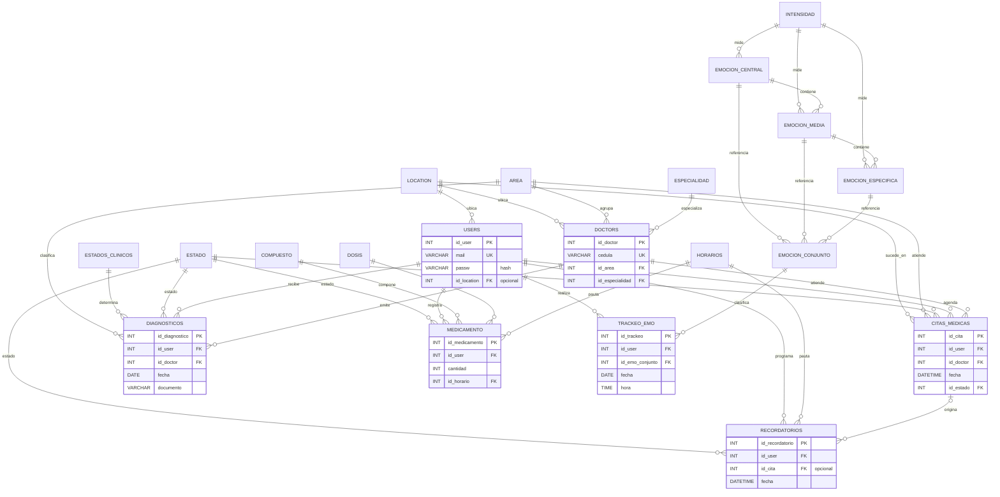

# Diagrama entidad-relación

El diagrama refleja `V002__create_relational_model.sql`. Las relaciones marcadas `o|` son opcionales en la tabla hija; las demás son obligatorias.

La tabla técnica `schema_migrations` no forma parte del dominio y se omite del diagrama.

