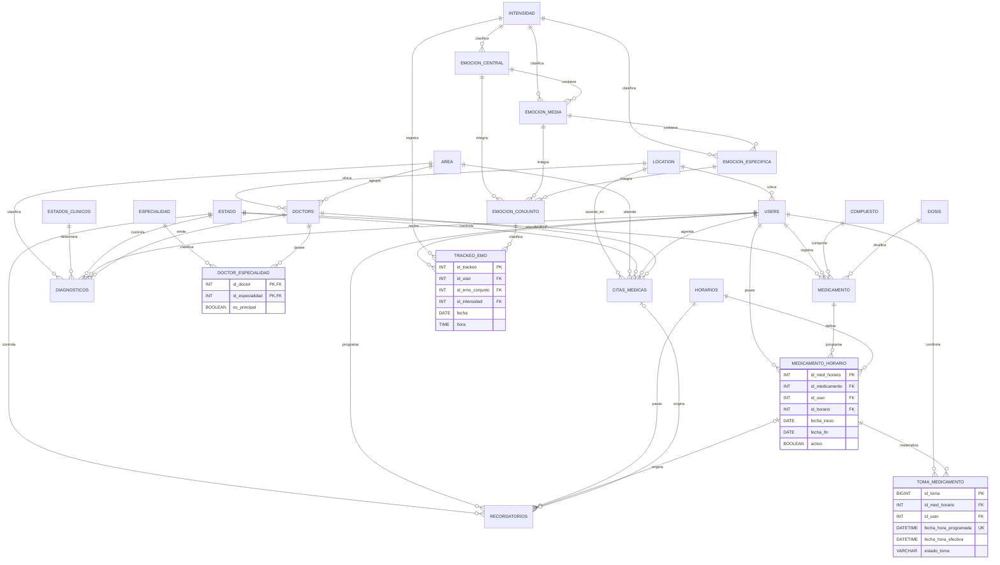

# Diagrama entidad-relación

Refleja las migraciones V001–V003. `o{` indica cero o muchos; las FK opcionales se explican en el diccionario.

`schema_migrations` es técnica y se omite. `medicamento.id_horario` y `doctors.id_especialidad` se conservan temporalmente por compatibilidad; los modelos nuevos usan las tablas puente.
