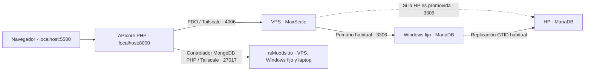

# Cómo conectamos y probamos Moodsitto

## Los cuatro equipos

| Equipo | IP de Tailscale | Qué ejecuta y qué aporta |
|---|---|---|
| Laptop Windows `DESKTOP-0DDRLDI` | `100.86.5.50` | Frontend en `localhost:5500`, APIcore PHP en `localhost:8000`, panel de pruebas y miembro de MongoDB con voto y prioridad 0. |
| Windows fijo `DESKTOP-SMECF2N` | `100.89.172.17` | Primario habitual de MariaDB en `3306`, con `server_id=1`. También es miembro elegible para primario de MongoDB en `27017`. |
| HP Ubuntu | `100.112.196.81` | Réplica MariaDB en `3306`, con `server_id=2`. Recibe cambios por GTID y puede asumir las escrituras. Guarda los respaldos de MariaDB. |
| VPS Ubuntu | `100.94.145.63` | MaxScale en `4006`. También ejecuta un miembro elegible de MongoDB en `27017` y guarda sus respaldos. |



## Cómo se armó, en orden

1. **Red privada.** Unimos los cuatro equipos a la misma red de Tailscale y usamos sus IP privadas en la configuración de los motores. Con el mismo dispositivo conectado a Tailscale, al cambiar de Wi-Fi se conserva su IP de Tailscale. En cada servidor configuramos la escucha y el firewall para los accesos del proyecto. SSH se usó para administración y diagnóstico. APIcore abre sus propias conexiones a las bases. [Direcciones de Tailscale](https://tailscale.com/docs/concepts/ip-and-dns-addresses)
2. **MariaDB.** Configuramos el Windows fijo con binlog y GTID, y la HP con un `server_id` diferente, sus propios registros de réplica y `read_only=ON`. Cargamos en la HP una copia inicial consistente y configuramos una cuenta dedicada de replicación con `MASTER_USE_GTID=slave_pos`. Los GTID permiten identificar qué transacciones ya aplicó cada nodo y desde dónde continuar. Verificamos los hilos de recepción y aplicación, el retraso y la llegada de una fila sintética. Los dos motores quedaron en la versión 11.8.6 antes de ensayar el cambio de roles. [Procedimiento del repositorio](../docs/replicacion/MARIADB_GTID.md)
3. **Conmutación MariaDB.** Instalamos MaxScale en el VPS, apuntamos su monitor `mariadbmon` a ambos nodos y configuramos el enrutador para conectar con el primario. Primero verificamos el enrutamiento con la promoción desactivada. Después habilitamos `auto_failover`, `auto_rejoin` y la comprobación de fallo del primario. Configuramos el Windows fijo para arrancar en solo lectura y poder reincorporarse tras una caída. En el ensayo detuvimos MariaDB, con su arranque programado, y dos comprobaciones confirmaron el resultado. El proxy identificó a la HP como destino de escritura y APIcore guardó y releyó un recordatorio. Al volver Windows, comprobamos que recibió ese registro. El retorno del primario a Windows fue un cambio planificado. [Operaciones del monitor de MariaDB](https://mariadb.com/docs/maxscale/reference/maxscale-monitors/mariadb-monitor/cluster-manipulation-operations)
4. **MongoDB.** Configuramos el mismo `replSetName: rsMoodsitto` y una llave interna compartida para autenticar a los miembros. Iniciamos el conjunto en el VPS y agregamos el Windows fijo y la laptop por sus IP de Tailscale. En la configuración del repositorio, el VPS tiene prioridad 2, el Windows fijo prioridad 1 y la laptop prioridad 0. La laptop replica y vota, y la prioridad 0 impide que sea elegida primario. APIcore usa los tres destinos y el nombre del conjunto para que el controlador descubra el primario. [Miembros de un replica set](https://www.mongodb.com/docs/manual/core/replica-set-members/) · [Miembros con prioridad 0](https://www.mongodb.com/docs/manual/core/replica-set-priority-0-member/)
5. **Aplicación y accesos.** El frontend de la rama `Fronted` llama a APIcore de la rama `api-citas`. APIcore usa PDO para cuentas y recordatorios en MariaDB y el controlador PHP de MongoDB para las emociones. El panel de `db-manager` importa el paquete de accesos cifrado con RSA-OAEP y almacena las credenciales con protección de Windows para la cuenta local. El lanzador las recupera al iniciar PHP. Para SSH usamos una llave independiente y verificamos la huella del Windows fijo.
6. **Respaldos.** Programamos con `systemd` las copias de MariaDB en la HP y las de MongoDB en el VPS. El panel comprueba la última ejecución y permite verificar por separado la restauración de `moodsitto` SQL, APIcore y MongoDB. Cada restauración recupera datos en un espacio temporal y comprueba su contenido.

## Qué mostrar en clase

| Si te preguntan… | Abre esto en el panel | Evidencia que debes señalar |
|---|---|---|
| ¿Cómo se alcanzan los equipos? | **Pruebas → Conectividad de los cuatro equipos** | Los puertos se comprueban usando las direcciones de Tailscale. |
| ¿Cómo sabes que MariaDB replica? | **Pruebas → MariaDB réplica HP** y **Replicación SQL con dato ficticio** | Ambos hilos activos, retraso observado y llegada de una fila de prueba. |
| ¿Dónde se ve el cambio de nodo? | **Recuperación → Ver caída del Windows fijo** | La HP fue promovida a los **63.69 s**. APIcore confirmó la escritura a los **65.94 s**. Windows se reincorporó a los **93.36 s**. |
| ¿Cómo comprobaste MongoDB? | **Pruebas → Replica set MongoDB** y **Recuperación → VPS · miembro MongoDB** | En el ensayo del VPS, el Windows fijo fue elegido a los **1.70 s**, confirmó una escritura por mayoría a los **2.40 s** y el VPS se reintegró a los **34.90 s**. |
| ¿Cómo comprobaste que la aplicación guarda datos? | **Inicio local → Ver estado** y el frontend | HTTP 200 de APIcore. Crea un recordatorio y una emoción ficticios y recarga para mostrar que ambos siguen disponibles. |
| ¿Qué pasa con las copias? | **Pruebas → 14A, 14B y 14C** | Las tres pruebas recuperaron contenido de respaldos reales en espacios temporales y lo validaron. |

El ensayo de caída de MariaDB usó APIcore en `8002` con MaxScale. Luego verificamos que la instancia habitual en `8000` llega al mismo MaxScale y admite inicio de sesión desde el frontend. Los tiempos corresponden a ensayos concretos.

### Comandos cortos para respaldar la explicación

Ejecuta desde la laptop. Estas comprobaciones son de solo lectura.

```powershell
tailscale ip -4
tailscale status
Test-NetConnection 100.94.145.63 -Port 4006 -InformationLevel Quiet
(Invoke-WebRequest http://localhost:8000/health -UseBasicParsing).StatusCode
(Invoke-WebRequest http://localhost:5500/login.html -UseBasicParsing).StatusCode
```

En una sesión SQL autorizada puedes enseñar `SELECT @@server_id, @@read_only, @@gtid_current_pos;` y, en la réplica, `SHOW REPLICA STATUS\G`. En MongoDB puedes mostrar `db.hello()` para identificar el conjunto y los roles.

### Archivos para enseñar si piden la configuración

- Para MariaDB, muestra la plantilla de la HP y cómo se inicializa desde una copia. [hp-replica.cnf](../mariadb/configuracion/hp-replica.cnf) · [inicializar-replica.sh](../despliegue/hp-ubuntu/inicializar-replica.sh)
- Para MongoDB, muestra la creación del replica set y la incorporación del Windows fijo y la laptop. [configurar-mongodb.sh](../despliegue/vps-ubuntu/configurar-mongodb.sh) · [agregar-windows-fijo.sh](../despliegue/vps-ubuntu/agregar-windows-fijo.sh) · [agregar-laptop.sh](../despliegue/vps-ubuntu/agregar-laptop.sh)
- Para APIcore, muestra cómo el lanzador decide el destino SQL y configura el controlador MongoDB. [iniciar-apicore.ps1](iniciar-apicore.ps1)

## Respuestas para la defensa

- **¿Tailscale hace la replicación?** Tailscale da conectividad entre las máquinas. MariaDB replica usando el binlog y GTID. MongoDB replica mediante el replica set.
- **¿Por qué hay MaxScale para MariaDB?** APIcore siempre apunta a la misma dirección SQL. MaxScale decide a qué primario enviar una conexión nueva. MongoDB ya tiene elección de primario dentro del conjunto y el controlador lo descubre a partir de los miembros configurados.
- **¿Qué pasa si apagas la laptop?** Se apagan el panel y las instancias locales del frontend y APIcore. Si el VPS y el Windows fijo siguen conectados entre sí, MongoDB conserva dos de sus tres votos. Si quedan menos de dos votos disponibles, MongoDB no puede mantener un primario que acepte escrituras. [Elecciones de MongoDB](https://www.mongodb.com/docs/manual/core/replica-set-elections/)
- **¿La recuperación es instantánea? ¿Se puede perder algún dato?** La recuperación de escritura en MariaDB tomó 65.94 s en el ensayo. Como la réplica es asíncrona, una caída puede dejar fuera transacciones que aún no llegaron a la HP. En MongoDB, la escritura del ensayo se confirmó con `w: "majority"`, que exige la confirmación de dos de los tres miembros con datos y voto en este conjunto. [Conmutación con MaxScale](https://mariadb.com/docs/maxscale/reference/maxscale-monitors/mariadb-monitor/cluster-manipulation-operations) · [Confirmación de escrituras de MongoDB](https://www.mongodb.com/docs/manual/core/replica-set-write-concern/)
- **¿Qué pasa si cae todo el VPS?** Se pierde el punto de acceso de APIcore a MariaDB porque MaxScale corre ahí. También se pierde un miembro de MongoDB. El ensayo de MongoDB detuvo solamente su motor, mientras MaxScale seguía disponible en el VPS.
- **¿Qué diferencia hay entre réplica y respaldo?** Una réplica aplica los cambios del primario, incluidos los borrados. Un respaldo conserva una copia de un momento determinado y permite recuperarla aparte.

### Guion de un minuto

> Primero conectamos los cuatro equipos a Tailscale. Así APIcore usa las mismas direcciones aunque la laptop cambie de red. En MariaDB, el Windows fijo registra las transacciones y la HP las replica por GTID. APIcore se conecta a MaxScale en el VPS. Cuando detuvimos MariaDB en Windows, MaxScale promovió a la HP. Confirmamos el cambio guardando y volviendo a leer un recordatorio desde APIcore. Después Windows volvió como réplica y recibió ese mismo registro. Para emociones usamos MongoDB con tres miembros. Al detener el motor del VPS, el conjunto eligió al Windows fijo y confirmó una escritura por mayoría. En el panel se pueden ver ambas líneas de tiempo.

Para abrir el panel y los servicios locales, usa la [guía de ejecución](EJECUTAR_INTERFAZ.md).
